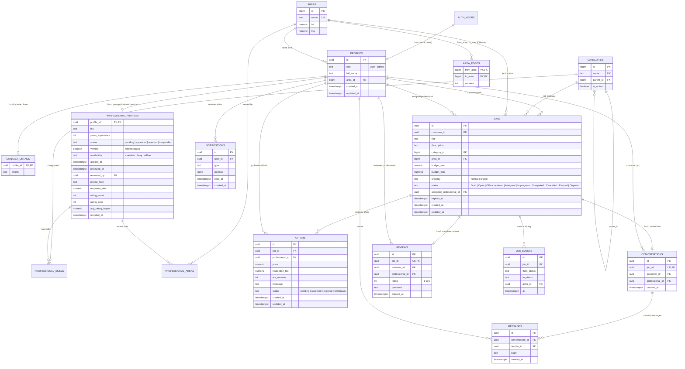
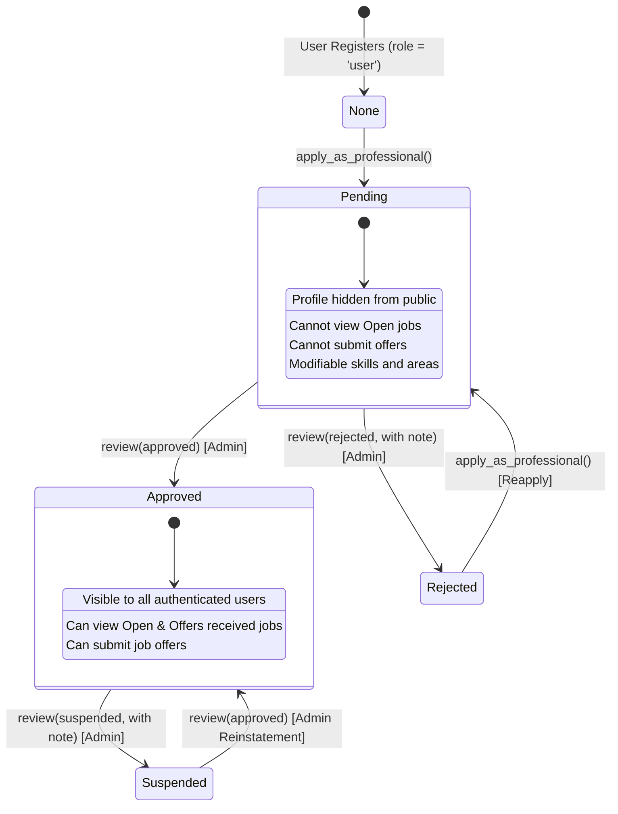

# ProLink Database Architecture (`db/`)

## Purpose
This directory contains the authoritative PostgreSQL database schema, helper functions, Row Level Security (RLS) policies, seed datasets, and policy validation test scripts for ProLink on Supabase.

---

## 1. Migration Run Order

All SQL scripts must be executed in the **Supabase Dashboard $\rightarrow$ SQL Editor** in the following sequence:

| Order | File Path | Type | Purpose |
| :---: | :--- | :--- | :--- |
| **1** | [`db/migrations/001_core_schema.sql`](file:///Users/mrcom/Documents/prolink/db/migrations/001_core_schema.sql) | DDL Migration | Creates 15 core tables, check constraints, foreign keys, and performance indexes. |
| **2** | [`db/migrations/002_functions_triggers.sql`](file:///Users/mrcom/Documents/prolink/db/migrations/002_functions_triggers.sql) | Logic Migration | Auth signup triggers, column security guards, review validator, and Bayesian rating updates. |
| **3** | [`db/migrations/003_rls.sql`](file:///Users/mrcom/Documents/prolink/db/migrations/003_rls.sql) | Security Migration | Enables RLS on all tables, defines client/admin policies, and configures Realtime. |
| **4** | [`db/migrations/004_google_onboarding.sql`](file:///Users/mrcom/Documents/prolink/db/migrations/004_google_onboarding.sql) | Legacy Migration | *(Superseded by 005)* Added onboarding flag and RPC for Google OAuth. Safe to run before 005. |
| **5** | [`db/migrations/005_dual_role_professional_applications.sql`](file:///Users/mrcom/Documents/prolink/db/migrations/005_dual_role_professional_applications.sql) | Dual-Role Migration | Migrates account roles to unified `user` / `admin`, adds application review lifecycle, drops legacy 004 onboarding objects, adds application RPCs, safety triggers, and RLS updates. |
| **6** | [`db/seed/001_categories_areas.sql`](file:///Users/mrcom/Documents/prolink/db/seed/001_categories_areas.sql) | Seed Data | Seeds 8 standard trade categories, 12 placeholder areas, and graph travel edges. |
| **7** | [`db/tests/rls_tests.sql`](file:///Users/mrcom/Documents/prolink/db/tests/rls_tests.sql) | Verification | Transactional test suite verifying RLS policies, trigger guards, dual-role workflows, and constraints. |

---

## 2. Entity-Relationship Diagram (ERD)



---

## 3. The Dual-Role Model

Under the unified dual-role architecture:
1. **Unified User Accounts**: Every registered user has `profiles.role = 'user'`. There is no role selection during signup. All users can immediately post jobs, compare quotes, and hire professionals.
2. **Applying as a Professional**: Any user account can apply to offer professional services. Applying creates a `professional_profiles` record with `status = 'pending'`, along with their selected trade skills, service coverage areas, and verified phone number.
3. **Application Review & Approval**: Only an administrator (`profiles.role = 'admin'`) can approve, reject, or suspend an application.
4. **Visibility & Capabilities**: Only professionals with `status = 'approved'` can view Open jobs in the marketplace, submit offers, appear in customer matching, and have their profile publicly visible.

### Application Status Flow



---

## 4. Database Functions & RPC Signatures

The web frontend and administrative interfaces interact with the following database functions:

### 1. `public.apply_as_professional`
* **Signature**:
  ```sql
  apply_as_professional(
      p_bio text,
      p_years int,
      p_category_ids bigint[],
      p_area_ids bigint[],
      p_phone text
  ) RETURNS void
  ```
* **Security**: `SECURITY DEFINER`, `SET search_path = ''`. Granted to `authenticated`.
* **Behavior**:
  - Validates bio length (30 to 1,000 characters).
  - Validates years of experience (0 to 60).
  - Validates trade categories (1 to 5 active categories).
  - Validates coverage areas (1 to 12 existing areas).
  - Validates phone format (plausible international/local 10 to 15 digits).
  - If no professional profile exists, inserts a new row with `status = 'pending'` and `verified = false`.
  - If the existing status is `'rejected'`, updates the row back to `'pending'`, resetting `reviewed_at`, `reviewed_by`, and `review_note`.
  - If status is `'pending'`, `'approved'`, or `'suspended'`, raises exception `22023`.
  - Atomically replaces `professional_skills` and `professional_areas`, and upserts `contact_details(phone)`.

### 2. `public.review_professional_application`
* **Signature**:
  ```sql
  review_professional_application(
      p_professional_id uuid,
      p_decision text,
      p_note text
  ) RETURNS void
  ```
* **Security**: `SECURITY DEFINER`, `SET search_path = ''`. Granted to `authenticated` (function enforces admin check internally).
* **Behavior**:
  - Requires caller to be an administrator (`public.is_admin() = true`).
  - Restricts `p_decision` to `'approved'`, `'rejected'`, or `'suspended'`.
  - Requires a non-empty `p_note` when rejecting or suspending.
  - Forbids administrators from reviewing their own application.
  - Updates `status`, sets `verified = (p_decision = 'approved')`, records `reviewed_by = auth.uid()`, `reviewed_at = now()`, and `review_note`.
  - Generates an in-app notification (`type = 'professional_application_reviewed'`) for the applicant.

### 3. `public.is_approved_professional`
* **Signature**:
  ```sql
  is_approved_professional(uid uuid) RETURNS boolean
  ```
* **Security**: `STABLE`, `SECURITY DEFINER`, `SET search_path = ''`.
* **Behavior**: Returns `true` if and only if the specified user has a `professional_profiles` record with `status = 'approved'`.

### 4. `public.is_admin`
* **Signature**:
  ```sql
  is_admin() RETURNS boolean
  ```
* **Security**: `STABLE`, `SECURITY DEFINER`, `SET search_path = ''`.
* **Behavior**: Returns `true` if the currently authenticated user (`auth.uid()`) has `role = 'admin'` in `public.profiles`.

### 5. `public.protect_sensitive_columns`
* **Trigger Target**: `BEFORE UPDATE ON public.profiles` and `BEFORE UPDATE ON public.professional_profiles`.
* **Behavior**: Blocks direct client-initiated updates (`CURRENT_USER IN ('authenticated', 'anon')`) to:
  - `profiles.role`
  - `professional_profiles.status`
  - `professional_profiles.verified`
  - `professional_profiles.applied_at`, `reviewed_at`, `reviewed_by`, `review_note`
  - `professional_profiles.response_rate`, `rating_count`, `rating_sum`, `avg_rating_bayes`

### 6. Safety Triggers
* `trg_validate_offer` on `public.offers`: Requires offering professional to satisfy `is_approved_professional()`, and forbids self-offers (`professional_id <> job.customer_id`).
* `trg_validate_review` on `public.reviews`: Requires job to be `Completed`, reviewer to match customer, professional to match assigned professional, and forbids self-reviews (`reviewer_id <> professional_id`).
* `trg_validate_conversation` on `public.conversations`: Forbids self-conversations (`customer_id <> professional_id`).

---

## 5. Row Level Security (RLS) Policy Adjustments

| Table | Policy Name | Command | Access Criteria |
| :--- | :--- | :---: | :--- |
| `jobs` | `jobs_select_authorized` | `SELECT` | Job customer, assigned professional, admin, OR approved professional (`is_approved_professional(auth.uid())`) when status is `Open` or `Offers received`. |
| `professional_profiles` | `professional_profiles_read_authenticated` | `SELECT` | Visible if `status = 'approved'`, owned by caller (`profile_id = auth.uid()`), or caller is an admin. |
| `professional_profiles` | `professional_profiles_update_owner` | `UPDATE` | Owner can update non-protected fields (protected fields blocked by trigger). |
| `professional_profiles` | `professional_profiles_admin_update` | `UPDATE` | Admins can update any professional profile. |
| `professional_skills` | `professional_skills_read` | `SELECT` | Visible if parent profile is `approved`, owned by caller, or caller is admin. |
| `professional_skills` | `professional_skills_insert_owner` / `update` / `delete` | Write | Modifiable by owner only while application status is `pending` or `approved`. |
| `professional_areas` | `professional_areas_read` | `SELECT` | Visible if parent profile is `approved`, owned by caller, or caller is admin. |
| `professional_areas` | `professional_areas_insert_owner` / `update` / `delete` | Write | Modifiable by owner only while application status is `pending` or `approved`. |

---

## 6. Key Assumptions & Follow-Up Directives

1. **Seed Data Sets**:
   All seed and test professionals must be inserted with `status = 'approved'` and `verified = true`.
2. **Backend Matching Engine & Data Generator**:
   - The Python synthetic data generator and C# Core API matching engine must query for:
     `status = 'approved' AND availability = 'available'`
   - Matching queries must explicitly exclude professionals where `professional_id = job.customer_id` to prevent self-matching.
3. **Admin Promotion**:
   Administrators cannot be created through signup or public RPCs. Administrators must be promoted manually by executing an SQL statement in the Supabase SQL editor:
   ```sql
   UPDATE public.profiles SET role = 'admin' WHERE id = '<target-user-uuid>';
   ```
4. **Superseded 004 Onboarding Artifacts**:
   The `onboarding_completed` column and `complete_onboarding()` function from migration 004 are superseded by the dual-role model. Migration 005 safely drops them with `IF EXISTS`. Google OAuth signups do not require a role selection step; all signups default directly to role `user`.
