# ProLink Database Architecture (`db/`)

## Purpose
This directory contains the authoritative PostgreSQL database schema, helper functions, Row Level Security (RLS) policies, seed datasets, and policy validation test scripts for ProLink on Supabase.

---

## 1. Migration & Script Run Order

All SQL scripts must be executed in the **Supabase Dashboard $\rightarrow$ SQL Editor** in the following sequence:

| Order | File Path | Type | Purpose |
| :---: | :--- | :--- | :--- |
| **1** | [`db/migrations/001_core_schema.sql`](file:///Users/mrcom/Documents/prolink/db/migrations/001_core_schema.sql) | DDL Migration | Creates 15 core tables, check constraints, foreign keys, and performance indexes. |
| **2** | [`db/migrations/002_functions_triggers.sql`](file:///Users/mrcom/Documents/prolink/db/migrations/002_functions_triggers.sql) | Logic Migration | Auth signup triggers, column security guards, review validator, and Bayesian rating updates. |
| **3** | [`db/migrations/003_rls.sql`](file:///Users/mrcom/Documents/prolink/db/migrations/003_rls.sql) | Security Migration | Enables RLS on all tables, defines client/admin policies, and configures Realtime. |
| **4** | [`db/migrations/004_google_onboarding.sql`](file:///Users/mrcom/Documents/prolink/db/migrations/004_google_onboarding.sql) | Legacy Migration | *(Superseded by 005)* Added onboarding flag and RPC for Google OAuth. Safe to run before 005. |
| **5** | [`db/migrations/005_dual_role_professional_applications.sql`](file:///Users/mrcom/Documents/prolink/db/migrations/005_dual_role_professional_applications.sql) | Dual-Role Migration | Migrates account roles to unified `user` / `admin`, adds application review lifecycle, drops legacy 004 onboarding objects, adds application RPCs, safety triggers, and RLS updates. |
| **6** | [`db/migrations/006_admin_portal.sql`](file:///Users/mrcom/Documents/prolink/db/migrations/006_admin_portal.sql) | Admin Portal Migration | Adds `profiles` suspension fields, `admin_actions` audit table, `reports` moderation table, `job_events.note`, admin RPCs, disputed-only chat privacy policy, and admin indexes. |
| **7** | [`db/seed/001_categories_areas.sql`](file:///Users/mrcom/Documents/prolink/db/seed/001_categories_areas.sql) | Seed Data | Seeds 8 standard trade categories, 12 placeholder areas, and graph travel edges. |
| **8** | [`db/seed/002_admin_demo_data.sql`](file:///Users/mrcom/Documents/prolink/db/seed/002_admin_demo_data.sql) | Demo Seed Data | *(Development Only)* Populates 24 demo users (`@example.invalid`), 12 approved pros, 3 pending & 1 rejected application, 40 jobs across all statuses over 30 days, offers, chats, reviews, 3 disputed jobs, 6 reports, and audit entries. |
| **9** | [`db/tests/rls_tests.sql`](file:///Users/mrcom/Documents/prolink/db/tests/rls_tests.sql) | Verification | Transactional test suite (auto-rolled back) verifying RLS policies, trigger guards, dual-role workflows, and admin portal functions (Tests 1–32). |
| **Cleanup** | [`db/seed/999_remove_demo_data.sql`](file:///Users/mrcom/Documents/prolink/db/seed/999_remove_demo_data.sql) | Demo Cleanup | Removes all records inserted by `002_admin_demo_data.sql`. |

---

## 2. Entity-Relationship Diagram (ERD)

```mermaid
erDiagram
    AUTH_USERS ||--|| PROFILES : "1-to-1 (auth.users)"
    PROFILES ||--o| CONTACT_DETAILS : "1-to-1 private phone"
    PROFILES ||--o| PROFESSIONAL_PROFILES : "1-to-1 pro application/extension"
    AREAS ||--o{ PROFILES : "home area"
    
    CATEGORIES ||--o{ CATEGORIES : "parent_id"
    CATEGORIES ||--o{ PROFESSIONAL_SKILLS : "categorized"
    PROFESSIONAL_PROFILES ||--o{ PROFESSIONAL_SKILLS : "has skills"
    
    AREAS ||--o{ AREA_EDGES : "from_area / to_area (Dijkstra)"
    AREAS ||--o{ PROFESSIONAL_AREAS : "served by"
    PROFESSIONAL_PROFILES ||--o{ PROFESSIONAL_AREAS : "serves area"
    
    PROFILES ||--o{ JOBS : "customer posts"
    CATEGORIES ||--o{ JOBS : "job category"
    AREAS ||--o{ JOBS : "job location"
    PROFILES ||--o{ JOBS : "assigned professional"
    
    JOBS ||--o{ OFFERS : "receives offers"
    PROFILES ||--o{ OFFERS : "professional bids"
    
    JOBS ||--o| CONVERSATIONS : "1-to-1 active chat"
    PROFILES ||--o{ CONVERSATIONS : "customer / pro"
    CONVERSATIONS ||--o{ MESSAGES : "contains messages"
    PROFILES ||--o{ MESSAGES : "sender"
    
    JOBS ||--o| REVIEWS : "1-to-1 completed review"
    PROFILES ||--o{ REVIEWS : "reviewer / professional"
    
    PROFILES ||--o{ NOTIFICATIONS : "receives alerts"
    JOBS ||--o{ JOB_EVENTS : "state audit log"
    PROFILES ||--o{ ADMIN_ACTIONS : "admin actor"
    PROFILES ||--o{ REPORTS : "reporter / target / resolver"
    JOBS ||--o{ REPORTS : "reported job"

    PROFILES {
        uuid id PK
        text role "user | admin"
        text full_name
        bigint area_id FK
        boolean is_suspended
        text suspended_reason
        timestamptz suspended_at
        timestamptz created_at
        timestamptz updated_at
    }

    CONTACT_DETAILS {
        uuid profile_id PK, FK
        text phone
    }

    PROFESSIONAL_PROFILES {
        uuid profile_id PK, FK
        text bio
        int years_experience
        text status "pending | approved | rejected | suspended"
        boolean verified "follows status"
        text availability "available | busy | offline"
        timestamptz applied_at
        timestamptz reviewed_at
        uuid reviewed_by FK
        text review_note
        numeric response_rate
        int rating_count
        int rating_sum
        numeric avg_rating_bayes
        timestamptz updated_at
    }

    CATEGORIES {
        bigint id PK
        text name UK "case-insensitive unique"
        bigint parent_id FK
        boolean is_active
    }

    AREAS {
        bigint id PK
        text name UK
        numeric lat
        numeric lng
    }

    AREA_EDGES {
        bigint from_area PK, FK
        bigint to_area PK, FK
        int minutes
    }

    JOBS {
        uuid id PK
        uuid customer_id FK
        text title
        text description
        bigint category_id FK
        bigint area_id FK
        numeric budget_min
        numeric budget_max
        text urgency "normal | urgent"
        text status "Draft | Open | Offers received | Assigned | In progress | Completed | Cancelled | Expired | Disputed"
        uuid assigned_professional_id FK
        timestamptz expires_at
        timestamptz created_at
        timestamptz updated_at
    }

    OFFERS {
        uuid id PK
        uuid job_id FK
        uuid professional_id FK
        numeric price
        numeric inspection_fee
        int eta_minutes
        text message
        text status "pending | accepted | rejected | withdrawn"
        timestamptz created_at
        timestamptz updated_at
    }

    CONVERSATIONS {
        uuid id PK
        uuid job_id UK, FK
        uuid customer_id FK
        uuid professional_id FK
        timestamptz created_at
    }

    MESSAGES {
        uuid id PK
        uuid conversation_id FK
        uuid sender_id FK
        text body
        timestamptz created_at
    }

    REVIEWS {
        uuid id PK
        uuid job_id UK, FK
        uuid reviewer_id FK
        uuid professional_id FK
        int rating "1 to 5"
        text comment
        timestamptz created_at
    }

    NOTIFICATIONS {
        uuid id PK
        uuid user_id FK
        text type
        jsonb payload
        timestamptz read_at
        timestamptz created_at
    }

    JOB_EVENTS {
        uuid id PK
        uuid job_id FK
        text from_status
        text to_status
        uuid actor_id FK
        text note
        timestamptz at
    }

    ADMIN_ACTIONS {
        uuid id PK
        uuid admin_id FK
        text action
        text target_type
        text target_id
        jsonb details
        timestamptz created_at
    }

    REPORTS {
        uuid id PK
        uuid reporter_id FK
        uuid target_user_id FK
        uuid target_job_id FK
        text reason
        text details
        text status "open | reviewing | resolved | dismissed"
        text resolution_note
        uuid resolved_by FK
        timestamptz resolved_at
        timestamptz created_at
    }
```



---

## 3. The Dual-Role & Admin Governance Model

1. **Unified User Accounts**: Every registered user has `profiles.role = 'user'`. All users can post jobs, compare quotes, and hire professionals.
2. **Applying as a Professional**: Any user account can apply to offer professional services via `apply_as_professional(...)`, creating a `professional_profiles` record with `status = 'pending'`.
3. **Application Review & Approval**: Only an administrator (`profiles.role = 'admin'`) can approve, reject, or suspend an application via `review_professional_application(...)`.
4. **Account Suspension**: Administrators can suspend or unsuspend user accounts via `admin_set_user_suspended(...)`. A suspended user (`profiles.is_suspended = true`) returns `false` from `is_approved_professional(uid)` and is signed out on login.
5. **Audit Trail**: Every administrative mutation writes an immutable record to `public.admin_actions`.

---

## 4. Database Functions & RPC Signatures

### 1. `public.apply_as_professional`
```sql
apply_as_professional(
    p_bio text,
    p_years int,
    p_category_ids bigint[],
    p_area_ids bigint[],
    p_phone text
) RETURNS void
```
- **Security**: `SECURITY DEFINER`, `SET search_path = ''`. Granted to `authenticated`.
- **Behavior**: Validates bio (30–1,000 chars), experience (0–60), categories (1–5 active), areas (1–12), and phone (10–15 digits). Inserts or resets a `'rejected'` application to `'pending'`, replaces skills and areas, and upserts `contact_details(phone)`.

### 2. `public.review_professional_application`
```sql
review_professional_application(
    p_professional_id uuid,
    p_decision text,
    p_note text
) RETURNS void
```
- **Security**: `SECURITY DEFINER`, `SET search_path = ''`. Granted to `authenticated` (enforces `public.is_admin()`).
- **Behavior**: Validates `p_decision IN ('approved', 'rejected', 'suspended')`, requires a note when rejecting or suspending, prevents self-review, updates `professional_profiles`, inserts a notification for the applicant, and records an audit entry via `log_admin_action`.

### 3. `public.admin_set_user_suspended`
```sql
admin_set_user_suspended(
    p_user_id uuid,
    p_suspended boolean,
    p_reason text DEFAULT NULL
) RETURNS void
```
- **Security**: `SECURITY DEFINER`, `SET search_path = ''`. Granted to `authenticated` (enforces `public.is_admin()`).
- **Behavior**: Requires a non-empty reason when `p_suspended = true`. Prevents an admin from suspending themselves or another admin. Updates `profiles.is_suspended`, `suspended_reason`, and `suspended_at`, and writes to `admin_actions`.

### 4. `public.admin_create_category` & `public.admin_update_category`
```sql
admin_create_category(
    p_name text,
    p_parent_id bigint DEFAULT NULL
) RETURNS bigint

admin_update_category(
    p_id bigint,
    p_name text,
    p_is_active boolean
) RETURNS void
```
- **Security**: `SECURITY DEFINER`, `SET search_path = ''`. Granted to `authenticated` (enforces `public.is_admin()`).
- **Behavior**: Validates trimmed category name length (2 to 60 characters), enforces case-insensitive uniqueness, inserts or updates `public.categories`, and logs to `admin_actions`.

### 5. `public.admin_resolve_report`
```sql
admin_resolve_report(
    p_report_id uuid,
    p_status text,
    p_note text DEFAULT NULL
) RETURNS void
```
- **Security**: `SECURITY DEFINER`, `SET search_path = ''`. Granted to `authenticated` (enforces `public.is_admin()`).
- **Behavior**: Validates `p_status IN ('reviewing', 'resolved', 'dismissed')`, requires a non-empty note for `'resolved'` and `'dismissed'`, updates `public.reports`, and logs to `admin_actions`.

### 6. `public.admin_overview`
```sql
admin_overview() RETURNS jsonb
```
- **Security**: `STABLE`, `SECURITY DEFINER`, `SET search_path = ''`. Granted to `authenticated` (enforces `public.is_admin()`).
- **Behavior**: Returns a JSON summary containing `total_users`, `new_users_last_7_days`, `professionals_by_status`, `jobs_by_status`, `jobs_last_7_days`, `open_reports`, `disputed_jobs`, and `pending_applications`.

### 7. `public.admin_jobs_by_day`
```sql
admin_jobs_by_day(
    p_days int DEFAULT 30
) RETURNS TABLE(day date, job_count bigint)
```
- **Security**: `STABLE`, `SECURITY DEFINER`, `SET search_path = ''`. Granted to `authenticated` (enforces `public.is_admin()`).
- **Behavior**: Accepts `p_days` between 1 and 60 and returns one row per calendar day (including days with zero jobs).

### 8. `public.log_admin_action` (Internal)
```sql
log_admin_action(
    p_action text,
    p_target_type text,
    p_target_id text,
    p_details jsonb DEFAULT '{}'::jsonb
) RETURNS uuid
```
- **Security**: `SECURITY DEFINER`, `SET search_path = ''`. Execution is revoked from `public`, `anon`, and `authenticated`; invoked only by internal `SECURITY DEFINER` admin functions.

### 9. `public.is_approved_professional` & `public.is_admin`
```sql
is_approved_professional(uid uuid) RETURNS boolean
is_admin() RETURNS boolean
```
- `is_approved_professional(uid)` returns `true` only if `professional_profiles.status = 'approved'` AND `profiles.is_suspended = false`.
- `is_admin()` returns `true` if the current user (`auth.uid()`) has `profiles.role = 'admin'`.

---

## 5. Row Level Security (RLS) Summary for Admin Portal

| Table | Policy Name | Command | Access Criteria |
| :--- | :--- | :---: | :--- |
| `admin_actions` | `admin_actions_select_admin` | `SELECT` | `public.is_admin()` only. No client write policies exist. |
| `reports` | `reports_insert_own` | `INSERT` | `reporter_id = (SELECT auth.uid())`. |
| `reports` | `reports_select_own_or_admin` | `SELECT` | Reporter (`reporter_id = (SELECT auth.uid())`) or `public.is_admin()`. Updates only via `admin_resolve_report`. |
| `messages` | `messages_select_participants` | `SELECT` | Conversation participants (`customer_id` or `professional_id`), OR `public.is_admin()` **only when the associated job status is `'Disputed'`**. |
| `job_events` | `job_events_select_admin` | `SELECT` | `public.is_admin()`, job customer, or assigned professional. |

---

## 6. How to Run Migration 006, Demo Seed & Admin Setup

1. **Apply Migration 006**:
   - Open the **Supabase SQL Editor**, paste the contents of [`db/migrations/006_admin_portal.sql`](file:///Users/mrcom/Documents/prolink/db/migrations/006_admin_portal.sql), and click **Run**.
2. **Load Demo Data (Optional, Development Only)**:
   - Confirm [`db/seed/001_categories_areas.sql`](file:///Users/mrcom/Documents/prolink/db/seed/001_categories_areas.sql) has been applied.
   - Run [`db/seed/002_admin_demo_data.sql`](file:///Users/mrcom/Documents/prolink/db/seed/002_admin_demo_data.sql) in the SQL Editor.
   - To remove all demo records later, run [`db/seed/999_remove_demo_data.sql`](file:///Users/mrcom/Documents/prolink/db/seed/999_remove_demo_data.sql).
3. **Create the Administrator Account**:
   - Follow the step-by-step instructions in [`db/ADMIN_SETUP.md`](file:///Users/mrcom/Documents/prolink/db/ADMIN_SETUP.md): register the user via the live site or Supabase Authentication $\rightarrow$ Users $\rightarrow$ Add user, then promote the account in the SQL Editor:
     ```sql
     update public.profiles set role = 'admin' where id = (select id from auth.users where email = '<ADMIN_EMAIL>');
     ```
4. **Run Automated RLS Tests**:
   - Paste [`db/tests/rls_tests.sql`](file:///Users/mrcom/Documents/prolink/db/tests/rls_tests.sql) into the SQL Editor and run it. Check the **Messages** tab to verify that `TEST 1` through `TEST 32` report `PASS` before the transaction rolls back.
